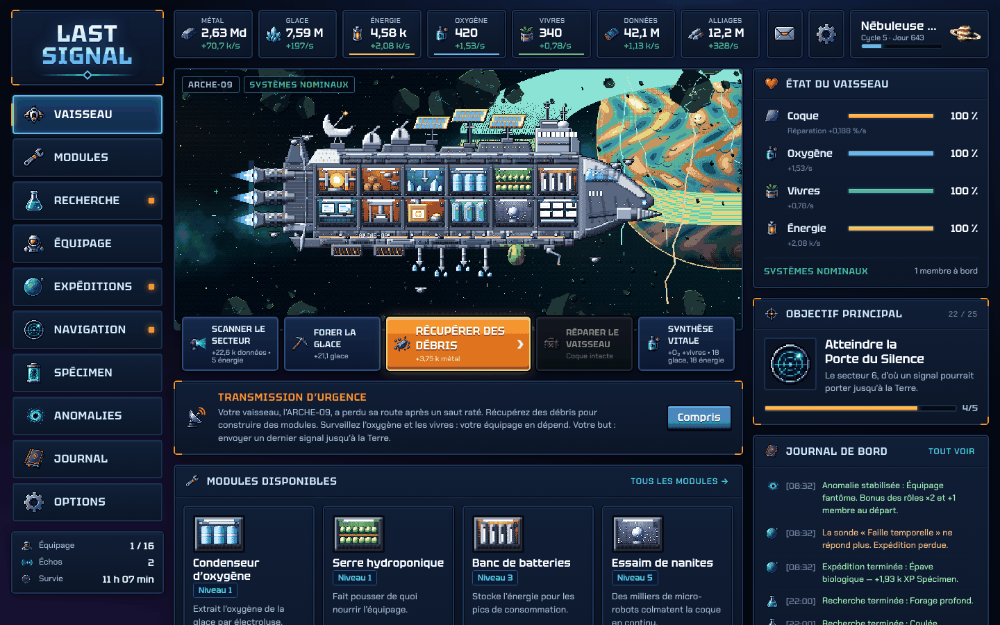

# Last Signal

Jeu incrémental (clicker) de survie spatiale, en pixel-art, entièrement en français.

Votre vaisseau, l'**ARCHE-09**, s'est égaré après un saut hyperspatial raté. À vous de le remettre en état, de garder l'équipage en vie et de trouver le chemin du retour.

## Jouer

**En ligne :** [vaekiel.github.io/Last-Signal](https://vaekiel.github.io/Last-Signal/)

Le jeu tourne directement dans le navigateur, sans rien à installer. La partie est enregistrée automatiquement. Le reste se découvre en jouant.

## Licence

© 2026 Vaekiel. Tous droits réservés. Le code est public pour consultation, mais n'est pas libre : consultation et jeu autorisés, réutilisation, redistribution ou revente soumises à autorisation. Voir [LICENSE](LICENSE).

Les polices sont chargées depuis Google Fonts et relèvent de leur propre licence (SIL Open Font License).
