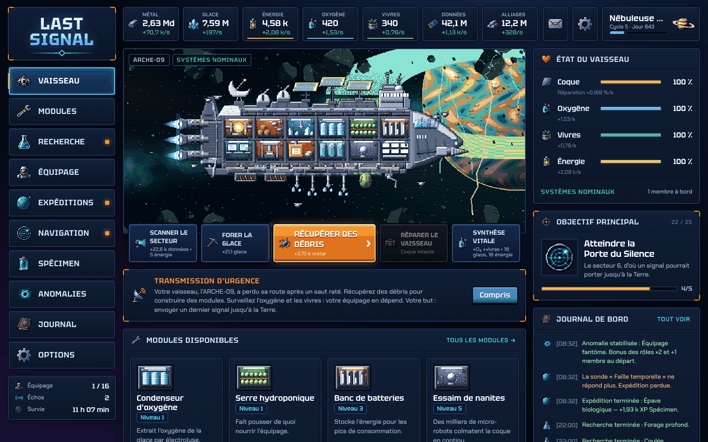

  

<h1 align="center">Last Signal</h1>

  <em>Un dernier appel dans le vide. Répare ton vaisseau, garde ton équipage en vie, et transmets le signal.</em>

  
  &nbsp;
  
  &nbsp;
  

  
  
  

---

**Last Signal** est un jeu incrémental (clicker) de survie spatiale en pixel-art, entièrement en français.

Votre vaisseau, l'**ARCHE-09**, s'est égaré après un saut hyperspatial raté. Les réserves fondent, l'équipage compte sur vous, et quelque part au loin, la Terre attend toujours un signe de vie. Récupérez des débris, reconstruisez l'ARCHE-09 pièce par pièce et frayez-vous un chemin de retour — un système après l'autre.

## ▶️ Jouer

**[vaekiel.github.io/Last-Signal](https://vaekiel.github.io/Last-Signal/)** — ça tourne directement dans le navigateur, **rien à installer**.

- La partie est **sauvegardée automatiquement** dans votre navigateur.
- Elle **continue de progresser** même fenêtre fermée.
- Pensé pour le bureau comme pour le mobile.

> Le reste se découvre en jouant. Pas de guide, pas de spoil ici : montez à bord.

## ✨ Au programme

- 🛰️ **Reconstruisez l'ARCHE-09** — récupérez des débris et transformez une épave en vaisseau capable de repartir.
- ⚙️ **Des modules à construire et améliorer** — chaque salle ajoutée change ce que produit votre vaisseau… et se voit à l'écran.
- 🔬 **Recherche & améliorations** — débloquez de nouvelles technologies pour tenir plus loin, plus longtemps.
- 🧑‍🚀 **Un équipage à garder en vie** — surveillez l'oxygène, les vivres et l'intégrité de la coque : la survie n'est jamais acquise.
- 🧭 **Des expéditions et des événements à choix** — des rencontres où vos décisions comptent, pour le meilleur et pour le pire.
- 🌌 **Des secteurs aux ambiances uniques** — chaque région traversée a son décor, ses dangers et son atmosphère.
- 🎨 **Un pixel-art animé fait main** — vaisseau évolutif, fonds en parallaxe et effets, dessinés au code image par image.
- 🔁 **De la rejouabilité** — des paliers à repousser et de quoi recommencer plus fort.

  

## 🖥️ Sous le capot

Last Signal est volontairement **sans dépendance** et **jouable hors ligne** : il suffit d'ouvrir `index.html`.

- **JavaScript vanilla**, zéro bibliothèque, zéro étape de build côté jeu.
- Un **moteur de rendu pixel-art maison** (matériaux, ombrages, tramage de Bayer) qui dessine icônes, vaisseau, fonds et créatures sur `<canvas>`.
- **Sauvegarde locale** automatique, simulation qui tourne même hors ligne.
- Seules les **polices** (Tektur, Chakra Petch) viennent de Google Fonts.

## 🎨 Contribuer aux graphismes

Le jeu sépare proprement **les mécaniques** (figées et équilibrées) et **les graphismes** (ouverts à l'amélioration). Si vous voulez toucher aux icônes, au vaisseau, aux fonds ou aux créatures :

- Lisez d'abord [`AGENTS.md`](AGENTS.md) — il fixe le périmètre et la direction artistique.
- Prévisualisez tout dans `tools/atelier.html`.
- Avant de proposer un changement : `node tools/verifier-graphismes.js` doit se terminer par `OK` (il garantit que l'équilibrage n'a pas bougé).

## 📜 Licence

© 2026 **Vaekiel**. Tous droits réservés. Le code est public pour consultation et transparence, mais **n'est pas libre** : consultation et jeu autorisés ; réutilisation, redistribution ou revente soumises à autorisation. Voir [`LICENSE`](LICENSE).

Les polices sont chargées depuis Google Fonts et relèvent de leur propre licence (SIL Open Font License).

— … réception d'un dernier signal … —

