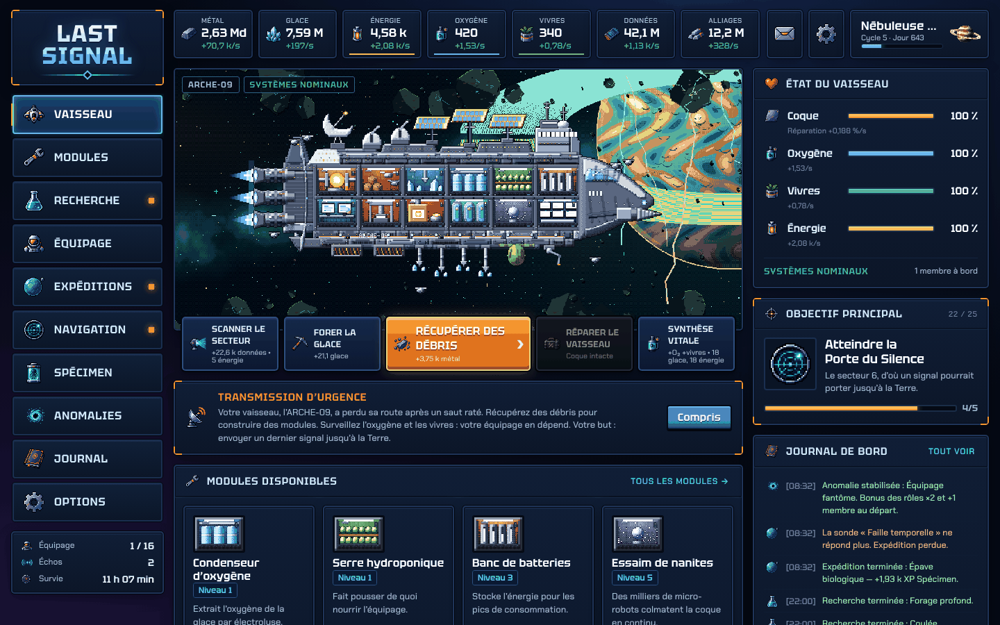

  

<h1 align="center">LAST SIGNAL</h1>

<strong>Un dernier appel dans le vide.</strong>

<em>Quelque part, au-delà des étoiles, quelqu'un attend encore votre signal.</em>

  
  &nbsp;
  
  &nbsp;
  

  
  
  
  

---

## ◈ Le silence après le saut

Il ne devait s'agir que d'un voyage.

Puis tout a basculé.

Le vaisseau **ARCHE-09** dérive désormais loin de sa route, perdu dans une immensité qui ne répond plus. Les instruments clignotent, les ressources s'amenuisent et chaque minute semble éloigner un peu plus l'équipage de chez lui.

Vous êtes encore là. L'ARCHE-09 aussi.

Mais pour combien de temps ?

**Last Signal** est un jeu de survie spatiale et de progression en pixel art, à vivre directement dans votre navigateur. À bord d'un vaisseau meurtri, vous devrez apprendre à faire face à l'inconnu, prendre des décisions et trouver votre propre chemin parmi les étoiles.

> **Ce qui vous attend au-delà du prochain signal ?** À vous de le découvrir. Ici, pas de solutions, pas de révélations : l'aventure commence à bord.

## ▶ Rejoindre l'ARCHE-09

**[◈ Jouer à Last Signal — Monter à bord](https://vaekiel.github.io/Last-Signal/)**

Le jeu est accessible gratuitement depuis un navigateur, **sans installation ni inscription**.

Votre progression est **sauvegardée automatiquement dans votre navigateur** et peut continuer à évoluer en votre absence. Elle reste locale à l'appareil utilisé : la suppression des données du navigateur peut effacer la sauvegarde.

L'expérience est pensée pour les ordinateurs, les tablettes et les téléphones. La version source peut également fonctionner sans connexion Internet, une fois les fichiers disponibles localement.

## ✧ Une traversée à vivre à votre rythme

- **Un vaisseau à ramener à la vie** — ce qui n'était qu'une épave peut encore devenir votre refuge.
- **Un équipage qui compte sur vous** — dans le vide, chaque décision a son importance.
- **Des horizons inconnus** — l'espace est immense, et toutes les rencontres n'ont pas encore eu lieu.
- **Une progression qui vous appartient** — observez l'ARCHE-09 évoluer au fil de votre voyage.
- **Un univers en pixel art animé** — une atmosphère spatiale entre solitude, espoir et découverte.

Nous préférons vous laisser rencontrer le reste en jouant.

## ◇ Un signal à partager

Une question, une découverte, une théorie ? Une situation vous résiste ou vous souhaitez simplement échanger avec d'autres voyageurs ?

Le **Discord de Noctiloom Studio** est destiné à accueillir l'entraide, les discussions, les retours des joueurs et les nouvelles du studio. Il est encore en construction ; le lien d'invitation officiel sera ajouté ici lorsqu'il sera prêt.

Pour préserver le plaisir des nouveaux joueurs, évitez les révélations et les solutions dans les titres des discussions. Les découvertes sont encore meilleures quand chacun peut les faire à son rythme.

En attendant, les problèmes techniques peuvent être signalés dans les [issues GitHub du projet](https://github.com/Vaekiel/Last-Signal/issues).

## ✦ Un jeu indépendant, libre d'accès

**Last Signal** est une création indépendante de **Vaekiel**, présentée au sein de **Noctiloom Studio**.

Le jeu est **entièrement gratuit**, sans achat en argent réel et sans compte obligatoire. Le projet peut évoluer : les retours des joueurs sont précieux pour améliorer l'expérience sans en dévoiler les surprises.

Envie d'explorer un autre univers ? Découvrez également **[AETHERIUM — Chroniques des Arcanes](https://github.com/Vaekiel/Aetherium)**, un jeu fantasy de collection et de découvertes.

## 📜 Droits et utilisation

© 2026 **Vaekiel** — Tous droits réservés.

Vous pouvez jouer gratuitement à la version officielle. Le dépôt GitHub est public pour consultation, mais **Last Signal n'est pas un logiciel libre**. La reproduction, la modification, la redistribution et l'exploitation du code ou des ressources sont soumises aux conditions de la [licence du projet](LICENSE), sous réserve des exceptions prévues par la loi.

Les polices tierces restent soumises à leurs licences respectives.

---

<em>« Ici l'ARCHE-09… Est-ce que quelqu'un nous reçoit ? »</em>

◈ LAST SIGNAL · Noctiloom Studio ◈

